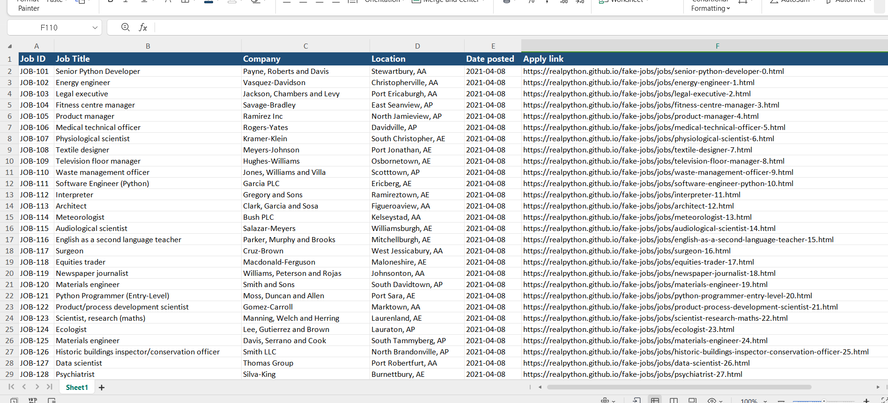

#  Remote Job Portal Data Scraper

A Python-powered automated web scraping tool engineered to extract live remote job listings, company credentials, locations, and direct application links, exporting clean datasets into professionally styled Excel spreadsheets.

---

## Dataset Preview (`job_listings.png`)
A visual preview of the exported job postings dataset:



---

##  Key Features & Extracted Data Points
* **Job ID:** Unique tracking code generated for inventory indexing.
* **Job Title:** Designation names (e.g., Senior Python Developer, Data Scientist).
* **Company Name:** Hiring organization or agency.
* **Location:** Remote / City location attributes.
* **Date Posted:** Listing recency verification.
* **Apply Link:** Direct URL redirection for job applications.

---

##  Tech Stack
* **Python** (Core Scripting)
* **Requests** (HTTP Requests)
* **BeautifulSoup4** (DOM Parsing & Data Scraping)
* **Pandas** (Data Transformation)
* **OpenPyXL** (Excel Styling & Output Generation)

---

##  How to Run

1. **Clone the repository:**
   ```bash
   git clone [https://github.com/samadch2/remote-jobs-data-scraper.git](https://github.com/samadch2/remote-jobs-data-scraper.git)
   cd remote-jobs-data-scraper
